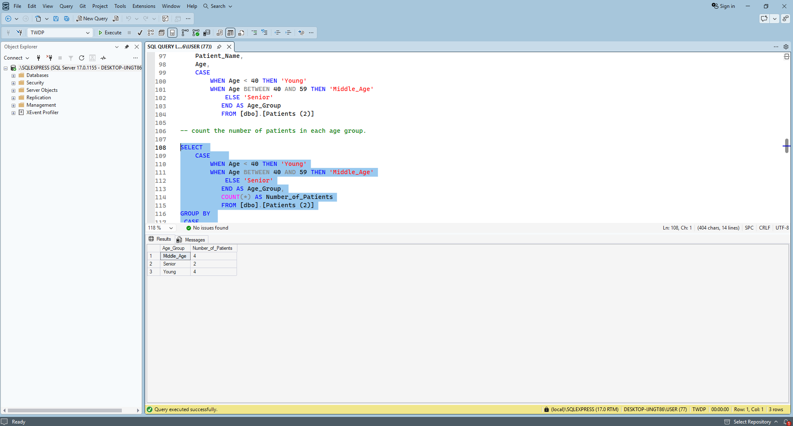
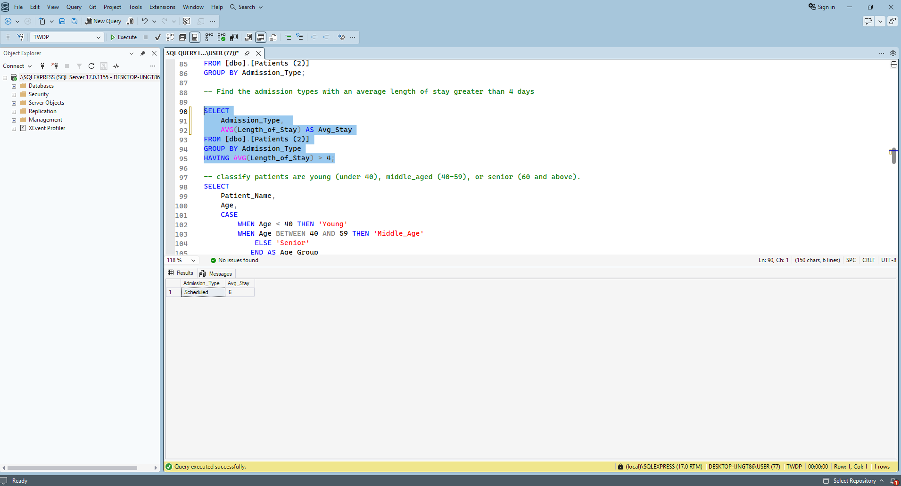
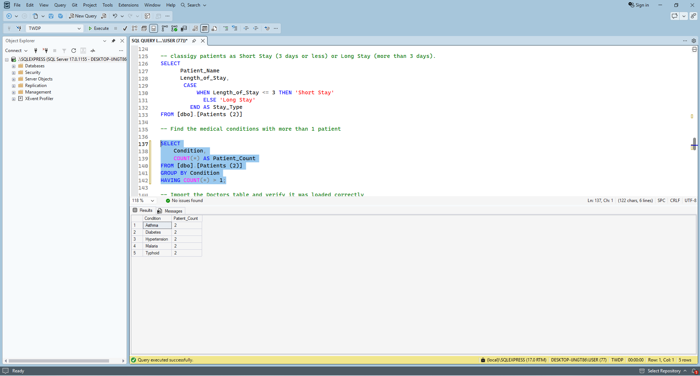
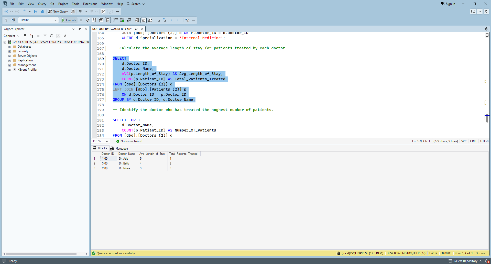
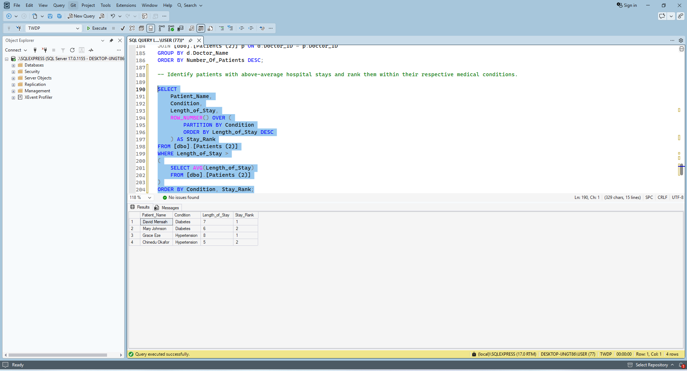

# Hospital Patient and Doctor Analysis Using SQL

### Healthcare Data Analysis | Microsoft SQL Server

## Table of Contents
- [Project Overview](#project-overview)
- [Business Problem](#business-problem)
- [Project Objectives](#project-objectives)
- [Business Questions](#business-questions)
- [Dataset Description](#dataset-description)
- [Tools and Technologies](#tools-and-technologies)
- [SQL Techniques Applied](#sql-techniques-applied)
- [SQL Analysis and Queries](#sql-analysis-and-queries)
- [Business Recommendations](#business-recommendations)
- [Conclusion](#conclusion)
- [Repository Structure](#repository-structure)
- [Author](#author)

## Project Overview

This project explores hospital patient and doctor records using Microsoft SQL Server to uncover insights into patient demographics, admission patterns, medical conditions, hospital stay duration, and doctor workload.

Through SQL queries, the project demonstrates how healthcare data can be transformed into meaningful information to support hospital management, resource allocation, and operational decision-making.

## Business Problem

Hospitals generate large volumes of patient and medical records, but extracting meaningful insights from these records is essential for effective management.

Hospital management needs to understand patient distribution, admission patterns, recurring medical conditions, hospital stay duration, and doctor workload.

This project addresses these needs by applying SQL techniques to explore patient records, identify patterns, and generate insights that can support better healthcare management decisions.

## Project Objectives

- Analyze average hospital stay across admission types.
- Classify patients by age and length of stay.
- Identify frequently occurring medical conditions.
- Examine relationships between patients and doctors.
- Evaluate doctor workload and patient distribution.
- Identify patients with above-average hospital stays.
- Apply advanced SQL techniques for data analysis.

## Business Questions

1. What is the average length of stay for each admission type?
2. Which admission types have an average stay greater than four days?
3. How are patients distributed across age groups?
4. Which medical conditions occur most frequently?
5. Which patients are treated by doctors specializing in Internal Medicine?
6. What is the average length of stay for patients treated by each doctor?
7. Which doctors have treated the highest number of patients?
8. Which patients have hospital stays above the overall average?
9. Which patients have the longest hospital stays?
10. How can patients be ranked by length of stay within each medical condition?

## Dataset Description

The project uses two relational tables:

**1. Patients Table**
- Patient ID
- Patient Name
- Age
- Admission Type
- Length of Stay
- Medical Condition
- Doctor ID

**2. Doctors Table**
- Doctor ID
- Doctor Name
- Specialization

The tables are connected through `Doctor_ID`, allowing patient records to be analyzed alongside doctor information.

## Tools and Technologies

- Microsoft SQL Server
- SQL Server Management Studio (SSMS)
- SQL
- GitHub

## SQL Techniques Applied

- SELECT and WHERE
- GROUP BY and ORDER BY
- HAVING
- Aggregate Functions (AVG, COUNT, MAX)
- CASE WHEN statements
- INNER JOIN and LEFT JOIN
- Subqueries
- Common Table Expressions (CTEs)
- Window Functions (ROW_NUMBER and PARTITION BY)

## SQL Analysis and Queries

The analysis covers five key areas using SQL Server to explore patient records, admission patterns, medical conditions, doctor workload, and hospital stay duration.

### 1. Patient Demographics

**Objective:** Classify patients into young, middle-aged, and senior categories and examine their distribution.

```sql
SELECT
    CASE
        WHEN Age < 40 THEN 'Young'
        WHEN Age BETWEEN 40 AND 59 THEN 'Middle-Aged'
        ELSE 'Senior'
    END AS Age_Group,
    COUNT(*) AS Number_of_Patients
FROM [dbo].[Patients (2)]
GROUP BY
    CASE
        WHEN Age < 40 THEN 'Young'
        WHEN Age BETWEEN 40 AND 59 THEN 'Middle-Aged'
        ELSE 'Senior'
    END
ORDER BY Number_of_Patients DESC;
```

**Query Result:**



### 2. Admission Analysis

**Objective:** Examine average hospital stays across admission types and identify categories with stays exceeding four days.

```sql
SELECT
    Admission_Type,
    AVG(Length_of_Stay) AS Avg_Length_of_Stay
FROM [dbo].[Patients (2)]
GROUP BY Admission_Type
HAVING AVG(Length_of_Stay) > 4;
```

**Query Result:**



### 3. Medical Conditions

**Objective:** Identify recurring medical conditions affecting more than one patient.

```sql
SELECT
    Condition,
    COUNT(*) AS Patient_Count
FROM [dbo].[Patients (2)]
GROUP BY Condition
HAVING COUNT(*) > 1;
```

**Query Result:**



### 4. Doctor Workload

**Objective:** Evaluate the number of patients treated and average hospital stay for each doctor.

```sql
SELECT
    d.Doctor_ID,
    d.Doctor_Name,
    AVG(p.Length_of_Stay) AS Avg_Length_of_Stay,
    COUNT(p.Patient_ID) AS Total_Patients_Treated
FROM [dbo].[Doctors (2)] d
LEFT JOIN [dbo].[Patients (2)] p
    ON d.Doctor_ID = p.Doctor_ID
GROUP BY d.Doctor_ID, d.Doctor_Name;
```

**Query Result:**



### 5. Patient Stay Duration

**Objective:** Identify patients with above-average hospital stays and rank them within their respective medical conditions.

```sql
SELECT
    Patient_Name,
    Condition,
    Length_of_Stay,
    ROW_NUMBER() OVER (
        PARTITION BY Condition
        ORDER BY Length_of_Stay DESC
    ) AS Stay_Rank
FROM [dbo].[Patients (2)]
WHERE Length_of_Stay >
(
    SELECT AVG(Length_of_Stay)
    FROM [dbo].[Patients (2)]
)
ORDER BY Condition, Stay_Rank;
```

**Query Result:**



### Summary

The project explores five major areas of healthcare data analysis using SQL Server, demonstrating:

- Patient classification using `CASE WHEN`.
- Data aggregation using `GROUP BY`, `AVG()` and `COUNT()`.
- Filtering aggregated results using `HAVING`.
- Relational analysis using `LEFT JOIN`.
- Advanced analysis using subqueries and window functions.
## Business Recommendations

- Monitor admission categories associated with longer hospital stays.
- Use patient demographics to support healthcare planning.
- Track recurring medical conditions for better resource allocation.
- Review doctor workload to identify potential staffing imbalances.
- Investigate factors contributing to extended hospital stays.

*Recommendations should be validated against actual analytical findings before implementation.*

## Conclusion

This project demonstrates the application of SQL in exploring healthcare data and extracting meaningful insights.

By analyzing patient demographics, admission patterns, medical conditions, and doctor assignments, the project highlights how SQL can support data-driven healthcare management and operational decision-making.

It also demonstrates practical proficiency in SQL querying, relational database analysis, and advanced analytical techniques.

## Repository Structure

```text
hospital-patient-doctor-analysis-sql/
│
├── README.md
├── data/
│   ├── Patients.csv
│   └── Doctors.csv
├── sql/
│   └── Hospital_Patient_Analysis.sql
├── images/
│   └── query_results.png
└── reports/
    └── Hospital_SQL_Analysis_Report.pdf
```

## Author

**Hassan Rosheedat Temitayo**

Data Analyst | SQL | Excel | Power BI | Python

[E-mail](rosheedathassan7@gmail.com) | [LinkedIn](www.linkedin.com/in/hassan-rosheedat-570a6340a)

I am passionate about transforming raw data into meaningful insights that support informed decision-making and solve real-world business problems.

This project reflects my practical application of SQL for relational database querying, data exploration, and analytical problem-solving.
